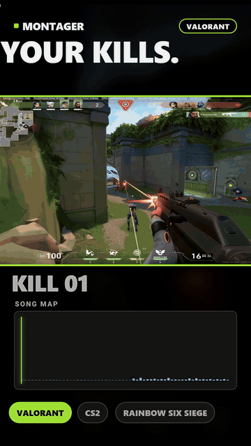
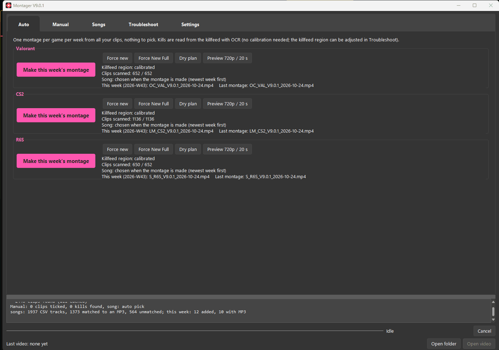
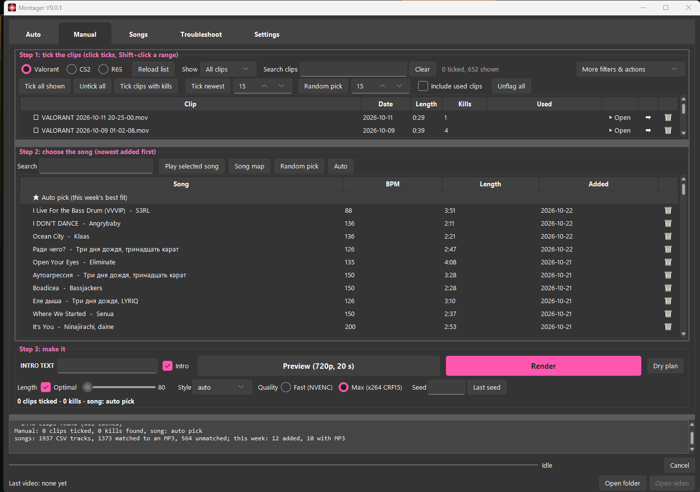

# Montager

Turns your own **Valorant, CS2 and Rainbow Six Siege** clips into kill montages cut to a song, automatically or by hand. It runs on your Windows PC; nothing is uploaded.

- **Finds your kills by itself** by reading the killfeed (offline OCR), only rows with *your* name.
- **Cut to the music:** kills land on the beats and every drop of the song gets a strong clip.
- **Effects:** slow-mo, speed ramps, zooms, flashes, transitions, sky recolour, intro title and outro.
- **Your songs:** a folder of MP3s is enough (a Spotify playlist CSV is optional).

## Download

**[Download Montager for Windows (installer)](https://github.com/fireaxe77/montager/releases/latest/download/Montager-Setup.exe)** (Windows 10 / 11, 64-bit; Python, FFmpeg and the OCR engine are included, no admin rights needed).
Also: [portable ZIP](https://github.com/fireaxe77/montager/releases/latest/download/Montager-Portable.zip) · [Python version](https://github.com/fireaxe77/montager/releases/latest/download/Montager-Python.zip) (see [INSTALL.md](docs/guides/INSTALL.md)) · [all releases and notes](https://github.com/fireaxe77/montager/releases).

Windows may say "Windows protected your PC" because the installer is not code-signed: click **More info > Run anyway**.

## Quick start

1. Install and start Montager. The first start lists what is still missing.
2. **Settings:** set your **MP3 folder**, your **clip folders** per game, your **in-game name** (exactly as the killfeed shows it) and an **output folder**.
3. **Troubleshoot > Scan all clips now.** Each clip is read once (about 7 to 17 s per clip) and cached for good.
4. **Auto tab > Dry plan** to see the cut list, then **Make this week's montage**. Prefer to choose yourself? Use the **Manual** tab.

| Auto tab | Manual tab |
|---|---|
|  |  |

## Good to know

- **Clips:** 1920x1080 at 60 fps with the default HUD and the killfeed in its default place (top right) is what it is built and tested on. NVIDIA ShadowPlay and OBS clips are tested; other setups may need the killfeed calibration (Troubleshoot > Calibrate killfeed region).
- **Songs:** every audio file in the MP3 folder is a song. A playlist CSV from [Exportify](https://exportify.app) only adds tempo, energy and "date added", and switches on **Download new songs** and **Add covers and tags** in the Songs tab.
- **Published montages:** if you uploaded a montage, Settings > Published montages > **Mark montage as published...** moves its clips out of your library so they are never used again (**Unmark published...** puts them back).
- **Your clips** are never edited. They are only moved when you click a move icon or mark a montage as published.
- **GPU:** an NVIDIA GPU renders faster (NVENC); without one Montager uses the CPU encoder. 16 GB RAM is recommended.
- Windows only. Detection has mainly been tested on the developer's setup, so check a **Dry plan** before rendering and report what did not work.

## More

[User guide](docs/guides/USER_GUIDE.md) (every setting, calibration, modes) · [Install details](docs/guides/INSTALL.md) · [Troubleshooting](docs/guides/TROUBLESHOOTING.md) · [Changelog](CHANGELOG.md) · [Credits and licenses](CREDITS.md)

Montager is a fan project, not affiliated with Riot Games, Valve or Ubisoft. Released under the [MIT License](LICENSE); the bundled fonts keep their own license (SIL OFL 1.1).
