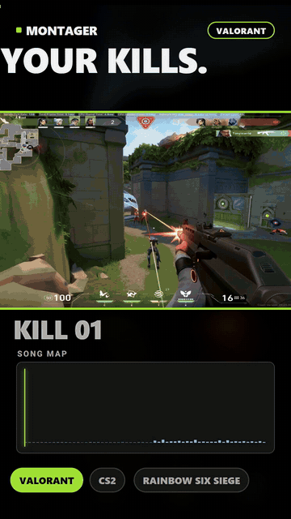
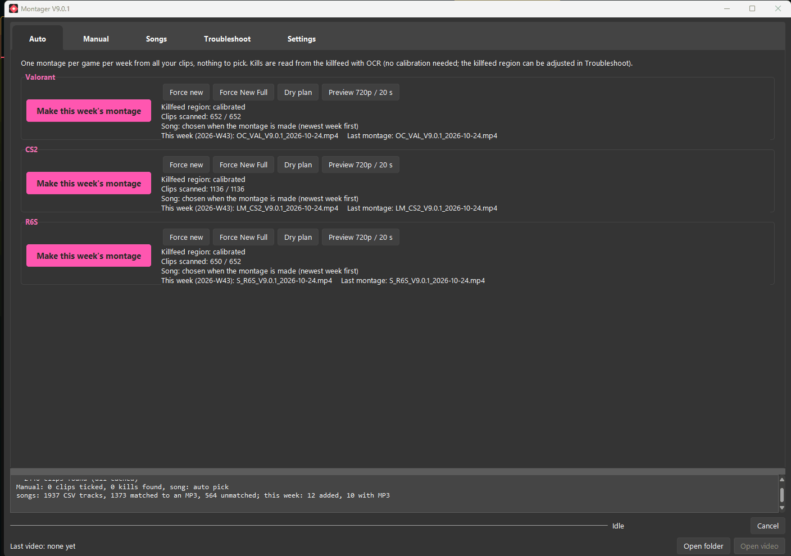
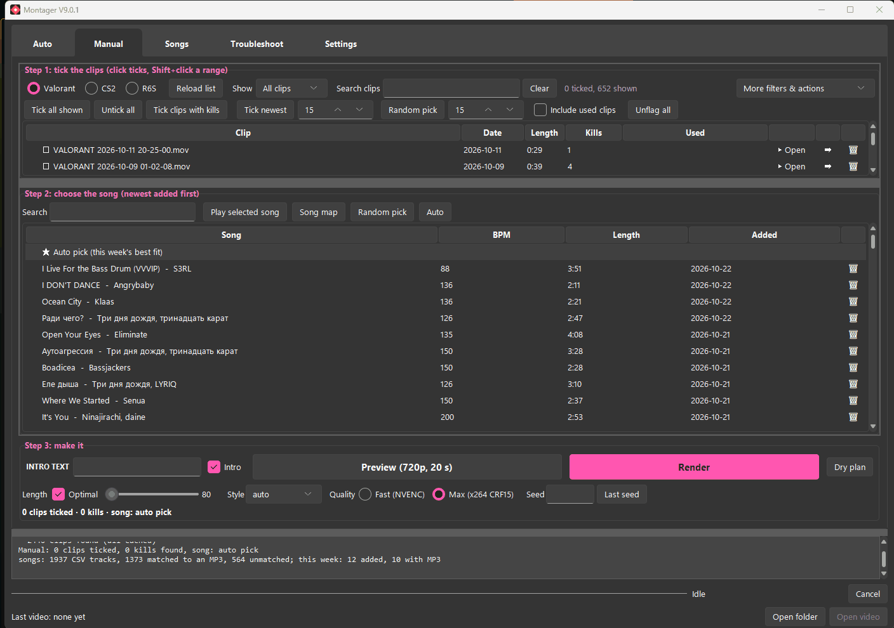
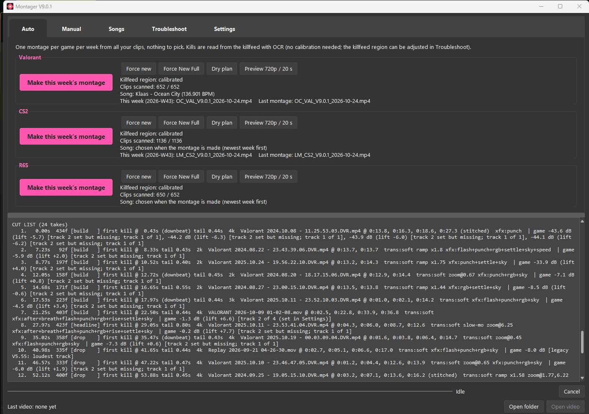
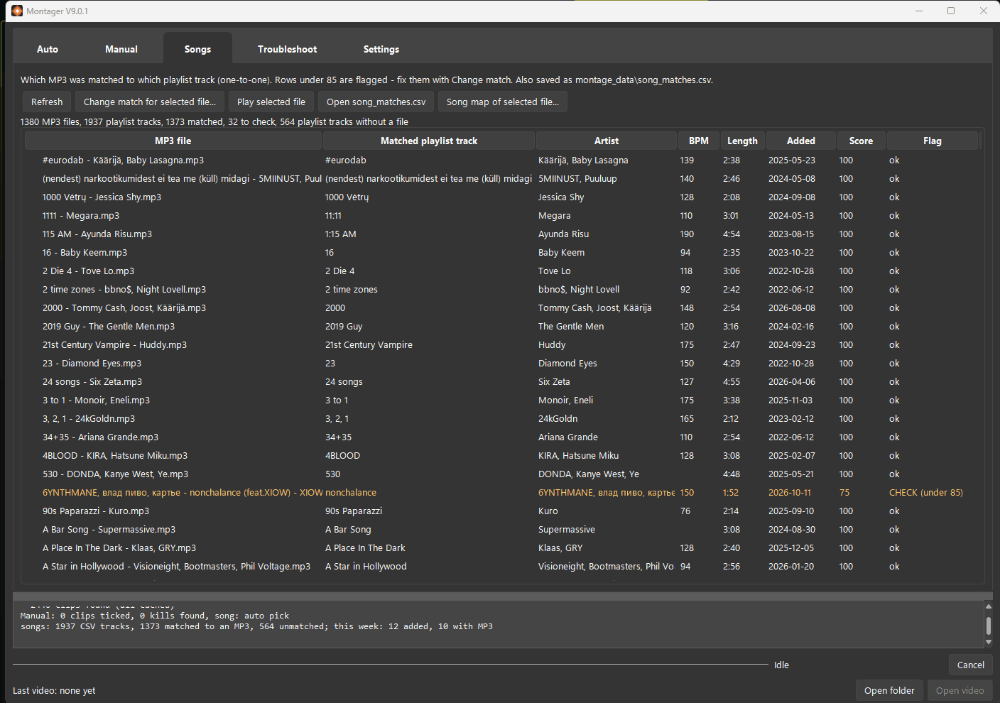

# Montager

Montager turns your own Valorant, CS2 and Rainbow Six Siege clips into kill montages cut to a song, automatically or by hand.

- **Finds your kills by itself:** reads the in-game killfeed (offline OCR) and keeps only rows with *your* name on the killer side.
- **Cut to the music:** every song gets a beat map (beats, sections, drops); kills land on beats and every drop gets a strong clip.
- **Effects:** slow-mo, speed ramps, zooms, flashes, transitions, sky recolour, and an intro title and outro, all chosen per montage.
- **Modes:** fully automatic (one montage per game per week) or Manual (you tick clips and pick the song).
- **Local:** runs on your Windows PC. Your clips are never changed and nothing is uploaded.

<p align="center"></p>

## Download

**[⬇ Download Montager for Windows (installer)](https://github.com/fireaxe77/montager/releases/latest/download/Montager-Setup.exe)**: Windows 10 / 11, 64-bit. Everything is included (Python, FFmpeg, the OCR engine); no admin rights needed.

- No installer wanted: [portable ZIP](https://github.com/fireaxe77/montager/releases/latest/download/Montager-Portable.zip) (unzip, double-click `Montager.exe`).
- Plain Python version: [Montager-Python.zip](https://github.com/fireaxe77/montager/releases/latest/download/Montager-Python.zip) (see [Install with Python](#install-with-python)).
- All versions and notes: [Releases](https://github.com/fireaxe77/montager/releases).

## Screenshots

| Auto tab | Manual tab |
|---|---|
|  |  |
| **A dry plan: the cut list** | **Songs tab** |
|  |  |

## Contents

[Download](#download) · [Requirements](#requirements) · [Install](#install) · [First-time setup](#first-time-setup) · [Your first montage](#your-first-montage) ·
[Settings](#settings-overview) · [Calibration and limitations](#calibration-and-limitations) · [Troubleshooting](#troubleshooting) · [Credits](#credits-and-licenses)

## Requirements

| What | Version / notes |
|---|---|
| Windows | Windows 10 or 11, 64-bit. |
| Installer / portable ZIP | Nothing else: Python, FFmpeg and the OCR engine are inside (about 700 MB installed). The rows below are only for the Python version. |
| Python | **3.12, 64-bit** from python.org, with tcl/tk (tkinter) installed. 3.10 / 3.11 may work but are not tested. |
| FFmpeg | A recent build with `ffmpeg` and `ffprobe`, for example the gyan.dev "essentials" build. |
| Python packages (required) | `numpy opencv-python Pillow librosa soundfile scipy mutagen rapidfuzz rapidocr-onnxruntime` |
| Python packages (recommended) | `sv-ttk` (the dark theme), `psutil` (memory readings), `fonttools` (intro titles in other alphabets) |
| OCR engine | RapidOCR (the `rapidocr-onnxruntime` package). Runs offline on the CPU; no separate install. |
| GPU (optional) | An NVIDIA GPU makes rendering faster (NVENC). The installed app switches to x264 by itself when there is no working NVIDIA encoder (slower, same result); the Python version: pick Quality "Max (x264)". |
| Disk / RAM | Space for the montages (about 100 to 400 MB each). 16 GB RAM recommended: a long render with effects can use about 10 GB. |
| Songs | Your own audio files plus a playlist CSV from [Exportify](https://exportify.app) (see [Songs](#1-songs)). |

More detail: [docs/guides/INSTALL.md](docs/guides/INSTALL.md).

## Install

### With the installer (recommended)

1. Download **[Montager-Setup.exe](https://github.com/fireaxe77/montager/releases/latest/download/Montager-Setup.exe)** and run it. Windows may show "Windows protected your PC" because the file is not code-signed: click **More info > Run anyway**.
2. Start **Montager** from the Start menu (or the desktop shortcut, if you ticked it).
3. The first start shows a short list of what is still missing (clip folders, songs, your in-game name). Click **Open Montager** and fill them in under Settings (next section).

- Your settings, caches and logs live in `%LOCALAPPDATA%\Montager\montage_data`. Updates and uninstalling keep them.
- Start menu > **Montager setup check** shows the full check at any time.

### Install with Python

1. **Python 3.12**: install it from [python.org](https://www.python.org/downloads/). Tick **"Add python.exe to PATH"**.
2. **FFmpeg**: open a terminal (cmd) and run
   ```bash
   winget install --id Gyan.FFmpeg -e --scope user
   ```
   Then close and reopen the terminal. No winget? See [INSTALL.md](docs/guides/INSTALL.md#ffmpeg).
3. **Montager**: download the ZIP from the [latest release](https://github.com/fireaxe77/montager/releases/latest) and unzip it to a folder of your own (for example `C:\Montager`). Or clone it:
   ```bash
   git clone https://github.com/fireaxe77/montager.git
   ```
4. **Python packages**: in that folder run
   ```bash
   python -m pip install --user numpy opencv-python Pillow librosa soundfile scipy mutagen rapidfuzz rapidocr-onnxruntime sv-ttk psutil fonttools
   ```
5. **Start it**: double-click **`Start_Montager.bat`**. It creates your settings file the first time, runs a read-only setup check, then opens Montager.
   - If the check finds a problem, it lists it with the fix and waits for a key press.
   - Run the check alone at any time: `python setup_check.py`.
   - Optional: double-click `Create_Desktop_Shortcut.vbs` once for a Desktop + Start menu shortcut.

## First-time setup

Everything below is in Montager's **Settings** tab. Changes are saved as you make them (`montage_data\config.json`).

### 1. Songs

- **MP3 folder**: the folder with your songs. Files named **`<title> - <artists>.mp3`**, for example `Ocean City - Klaas.mp3`. Several artists: `Title - Artist A, Artist B.mp3`. mp3, flac, m4a, wav, ogg and opus all work. Tags inside the file (title / artist) are used when present.
- **Exportify CSV folder**: the folder with your playlist CSV. Montager reads the newest `.csv` in it.
  1. Open [exportify.app](https://exportify.app) and log in with Spotify.
  2. Click **Export** next to the playlist that holds your montage songs.
  3. Save the `.csv` into the Exportify CSV folder (it can be the same folder as the songs).
- The CSV supplies the tempo, energy and "date added" of each song. A song needs **both** a file and a CSV row (title + an artist must match) to be used.
- Check the result in the **Songs** tab: each file, the playlist track it matched, and a flag for anything to check.
- Songs are newest-first: Auto prefers the songs added most recently to the playlist.

### 2. Clip folders

- Add one or more folders per game: **Valorant clip folders**, **CS2 clip folders**, **R6S clip folders** (Add folder, or separate several with `;`). Sub-folders are included.
- The list a folder is in decides the game. Leave a game empty if you don't play it.
- What a clip should be:

| | |
|---|---|
| Files | `.mp4`, `.mov` or `.mkv`, at least 1 MB |
| Length | short clips: up to **60 s** and **60 MB** by default (Settings > Scanning: "Skip clips longer than" / "Skip files larger than") |
| Resolution | 1920x1080 is what it is built and tested on. Other 16:9 sizes should work. 4:3 / stretched with black bars works after the black-bar crop is measured (Troubleshoot > Black bars). |
| Frame rate | 60 fps recommended. Clips under 20 fps are treated as broken and skipped. |
| Killfeed | must be visible and in its default place (**top right**). Turn off anything that covers it. |
| HUD / UI | default in-game HUD scale and killfeed look. Big HUD changes can need [calibration](#calibration-and-limitations). |
| Recorder | NVIDIA ShadowPlay / Instant Replay and OBS replay buffer clips are what it is tested on. Other recorders should work if the files are normal H.264 / HEVC. |
| Audio | game sound in the clip. If your recorder saves several audio tracks (game / mic / Discord), Settings > Game audio picks the game track (Auto = the track with the most gunshots). |

- Keep the clip's kills **inside** the clip: a kill in the last half second may be cut short.

### 3. Player names

- **Settings > Player names**: your in-game name for each game, exactly as the **killfeed** shows it. Several names (old names, smurfs): separate them with `;`.
- **Why:** a killfeed row only counts as *your* kill when your name is first on the killer side. A wrong name means no kills found; a teammate's name means their kills are used.
- Letter case doesn't matter. OCR slips like `l`/`i` and `0`/`O` are tolerated (Settings > "fuzzy name match needed", default 80).
- CS2 names in other alphabets (for example Chinese characters) are supported as an extra name.
- After changing names, the affected clips are re-checked automatically.

### 4. Output folder

- **Output folder**: where montages go: `<Output folder>\<Game>\<SONG INITIALS>_<VAL|CS2|R6S>_<version>_<date>.mp4`.
- Each montage gets a `logs\` folder next to it with its plan (`.txt` + `.json`).

### 5. The first scan

- Before Montager can plan, each clip is scanned once: the killfeed is read frame by frame with OCR and every row is classified (kill, death, assist, revive). Results are **cached for good**. Only new clips are scanned later.
- Start it with **Troubleshoot > Scan all clips now**, or let **Auto** / **Dry plan** scan what it needs (Auto scans clips from the last 30 days plus up to 150 older ones per run; R6S at most 12 new clips per run).
- **How long:** roughly **7 to 17 seconds per clip** (2 clips at once, OCR on the CPU). One data point, the developer's PC (Ryzen 7 5800X, RTX 3080, 1080p60 clips of 15 to 60 s): 210 clips took 25 min, 512 clips 2 h 20 min, a library of about 2,400 clips most of a day spread over several runs.

| Clips | First scan (rough) |
|---|---|
| 50 | 6 to 15 min |
| 200 | 25 to 60 min |
| 500 | 1 to 2.5 h |
| 2,000 | 4 to 9 h (run it overnight, or let Auto do it in steps) |

- You can stop a scan (Cancel) and continue later: finished clips stay cached.
- Song maps are built the same way (once per song, a few seconds each), the first time a song is considered.

## Your first montage

1. Open **Settings**: songs, CSV, clip folders, player names, output folder (see above). Run the setup check (Start menu > **Montager setup check**; Python version: `python setup_check.py`) until it says **ready**.
2. **Troubleshoot > Selfcheck**: every line should say OK.
3. **Troubleshoot > Scan all clips now** (or skip this and let step 5 scan in smaller steps).
4. **Troubleshoot > Self-test detection**: shows what the OCR read and why each row counted or not. This is the quickest way to see your player names work.
5. **Auto tab > Dry plan** for your game: plans a montage without rendering it and prints the song, the style and the cut list (which clip, which kills, which beat).
6. **Preview 720p / 20 s**: a short low-quality render to check the look.
7. **Make this week's montage**: the real render. **Open video** opens it when done.

Prefer to choose yourself? Use the **Manual** tab:

1. Tick clips (click; Shift+click for a range). The list shows date, length, kills and whether a clip was used before.
2. Pick a song, or keep "Auto pick".
3. Optional: intro text, length (Optimal or a fixed 80 to 180 s), style, quality, seed.
4. **Dry plan**, **Preview**, or **Render**.

### Modes

| Mode | Where | What it does |
|---|---|---|
| **Weekly** ("Make this week's montage") | Auto tab | One montage per game per week from your clips, with the song chosen for you. Run it again in the same week and it says the week's montage already exists. |
| **Force new** | Auto tab | A new automatic montage now, even if this week's exists, from clips not used before. |
| **Force New Full** | Auto tab | Like Force new, but the montage fills the whole song (up to 3:00 with intro and outro; a long song uses its best section). |
| **Manual** | Manual tab | You tick the clips and pick the song; Montager plans the cut. |
| **Manual Auto** | Manual tab, **Auto** button next to the songs | Select a song, click Auto: it ticks enough clips (unused first) to fill that song. Review the ticks, then render. |

- Clips used in a rendered montage are flagged "used" and skipped by the automatic modes (Manual: "Include used clips" shows them).
- **Dry plan** and **Preview** never flag anything.

## Settings overview

| Section | What's there |
|---|---|
| Folders | MP3 folder, Exportify CSV folder, output folder, moved-clips folder, clip folders per game |
| Scanning and detection | max clip size / length, how many clips Auto scans per run, fuzzy name match, "no kills after my death" window, what "this week" means |
| Killfeed region | the saved region per game and which clips were scanned with it (calibration itself is in Troubleshoot) |
| Game audio | the game audio level under the music (per game) and which audio track of a clip is the game sound (Auto = the one with the most gunshots, or track 1 / 2 / 3) |
| Player names | your in-game names per game |
| Montage | default length (Optimal or fixed seconds), quality (Fast NVENC / Max x264), Effects per game (Default = minimal, Extra = more effects and transitions), sky recolour per game, low-fps takes, lowering clips that have music in them, reports and checks after a render |
| Appearance | accent colour, base colour, UI mode |
| General | check for updates on start (git installs only; off by default) |

- **Move-to-folder icon** (clip list, arrow): moves a clip out of your clip folders into the "Moved clips" folder, so no montage uses it again.
- **High performance UI mode** (Settings > Appearance): the same app with a flat, lighter theme for slower PCs.

## Calibration and limitations

**Be aware:** detection has mainly been tested on the developer's own setup: 1920x1080, default HUD, NVIDIA / OBS recordings, and one set of player names. On other resolutions, HUD settings or recorders it may need calibration, or it may find fewer kills or the odd wrong one. Always check a **Dry plan** before rendering, and please report what didn't work.

### Killfeed calibration

- **What:** the killfeed region is the rectangle of the screen Montager reads with OCR. The default is the top-right area, which fits the default HUD of all three games at 16:9.
- **When you need it:** Self-test detection reads no rows, or misses kills you can see; your killfeed is moved or scaled (HUD scale, a minimap or overlay in the way); you play stretched or at an unusual resolution.
- **How:**
  1. Troubleshoot > **Calibrate killfeed region (optional)...**
  2. Pick the game at the top.
  3. **Open clip...** and drag the slider to a moment with several killfeed rows (or **Open screenshot...**).
  4. Drag a box around the **whole** killfeed area, with some room for long rows.
  5. **Test OCR on this frame**: the rows it reads, and how many are your kills.
  6. **Save region**. Clips of that game are re-scanned with the new region. **Reset to default** undoes it.
- **Black bars** (4:3 / stretched clips): Troubleshoot > Black bars > **Re-measure** measures the crop once; "Before/after preview" shows it.

### Known limitations

- Windows only. Built and tested on Windows 11 with Python 3.12.
- English-alphabet names work best; very short or very common names can match other players.
- Kills by abilities, utility or assists are not counted; knife kills are.
- Very long clips (over 60 s) are skipped by default; raise the limit in Settings if you need them.
- The first scan of a big library takes hours (once).
- R6S: clips are scanned only when they are picked or ticked (at most 12 new ones per automatic run).
- No installer; Python and FFmpeg are installed separately.

## Troubleshooting

| Problem | Fix |
|---|---|
| Nothing happens on double-click | Installed app: Start menu > Montager setup check. Python version: run `Start_Montager.bat`: it shows what's missing. Or open a terminal in the folder and run `python montage.py` to see the error. |
| "Missing packages" | Click Yes to install, or run the `pip install` line from [Install](#install). |
| `ffmpeg not found` | Install it (step 2), then open a **new** terminal / restart Montager. Or put `ffmpeg.exe` + `ffprobe.exe` into `montage_data\bin`. |
| NVENC test fails | Update the NVIDIA driver, or choose Quality "Max (x264)". |
| 0 kills found | Check the player names (exactly as in the killfeed), run Self-test detection, then [calibrate](#killfeed-calibration). |
| Songs missing or "unmatched" | Check the Songs tab: the file name / tags and the CSV must share the title and an artist. "Change match" fixes one by hand. |
| No CSV found | Settings > Exportify CSV folder must hold the `.csv`; the newest one is used. |
| Render is slow or runs out of memory | Close other heavy apps; use Effects "Default" and/or a shorter length. |
| Something else | Troubleshoot > **Open logs** (`montage_data\logs\montage.log`). Include the end of it when you report a problem. |

More: [docs/guides/TROUBLESHOOTING.md](docs/guides/TROUBLESHOOTING.md) · Project layout: [docs/PROJECT_STRUCTURE.md](docs/PROJECT_STRUCTURE.md) · Version history: [CHANGELOG.md](CHANGELOG.md) (readable version: Settings > Changelog).

## Credits and licenses

- Fonts: Anton, Bebas Neue, Montserrat, Oswald, Playfair Display and Unbounded, under the SIL Open Font License 1.1 ([fonts/OFL.txt](fonts/OFL.txt)).
- Uses Python, FFmpeg, RapidOCR / ONNX Runtime, OpenCV, NumPy, SciPy, librosa, soundfile, mutagen, RapidFuzz, Pillow and sv-ttk (installed separately; see [CREDITS.md](CREDITS.md)).
- Montager is a fan project, not affiliated with Riot Games, Valve or Ubisoft.
- Montager itself is released under the [MIT License](LICENSE). The bundled fonts keep their own license (SIL OFL 1.1).
